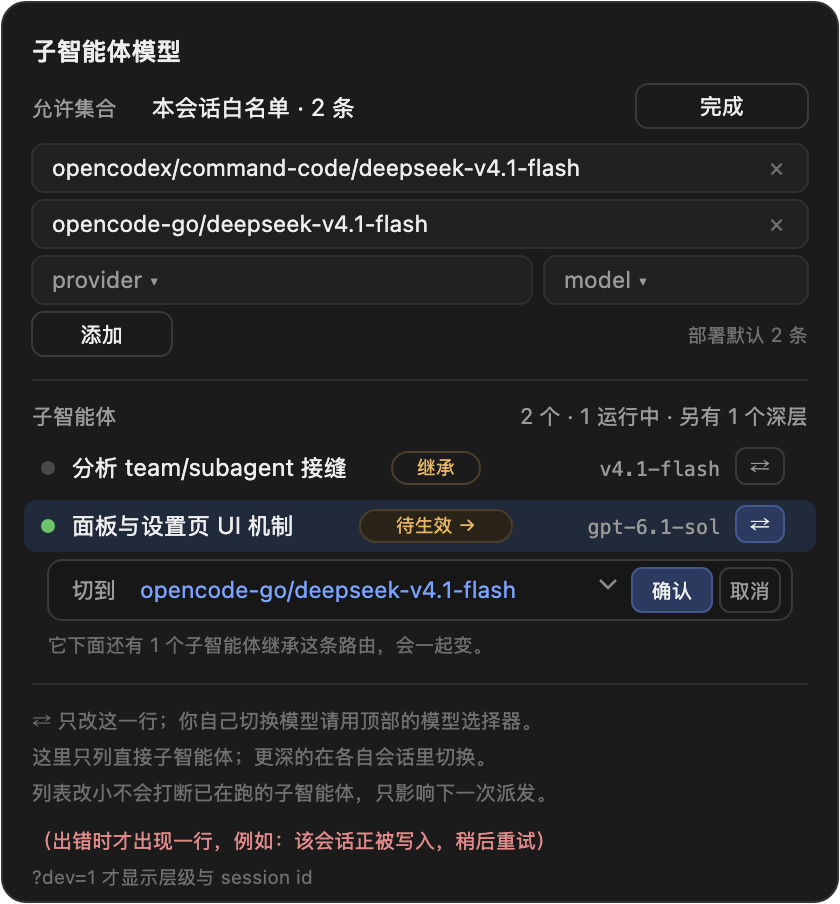

# dsh-subagent-model-router

[中文](README.md) | [English](#)

Give DeepSeek Harness subagents a model route you can **pin, re-point at any time, and constrain per conversation**. Mounts inside Agent Teams when present, and into root conversations when it is not.

- Compatibility: seams were read from **0.2.1-rc.5**; declared window `>=0.2.1-rc.5 <0.3.0`
- Zero dependencies: plain ESM, no `@deepseek-ai/*` imports
- Licence: MIT

## Contents

- [Features](#features)
- [Install](#install)
- [Usage](#usage)
- [Configuration](#configuration)
- [User interface](#user-interface)
- [Allow-set semantics](#allow-set-semantics)
- [Compatibility and degradation](#compatibility-and-degradation)
- [Side effects and permissions](#side-effects-and-permissions)
- [Troubleshooting](#troubleshooting)
- [Known limits](#known-limits)
- [Development and testing](#development-and-testing)
- [Uninstall](#uninstall)
- [Related plugins](#related-plugins)
- [Licence](#licence)

## Features

| Capability | Entry point | Problem it solves |
| --- | --- | --- |
| Choose the model at creation | `spawn_teammate_with_model` (with a Team) / `spawn_subagent_with_model` (without) | Built-in delegation can only inherit the parent route |
| Re-point a live child, repeatedly | `switch_agent_model` | After an endpoint dies (quota, revoked key, dead proxy, persistent 4xx/5xx) move the work instead of restarting it |
| Conversation-scoped allowlist (hard gate) | `configure_subagent_models` + the dock panel | The shipped `allowedModels` only checks an explicitly requested route, never a pure inheritance |
| Visibility | header chip / panel / sidebar hover | A subagent header is the only place its route is ever stated |
| No recursion | a teammate has no spawn tool | A child that delegates would recurse; the assembly layer prevents it |
| Bilingual UI | follows the harness locale | Panel text follows the language setting, no reload |

## Install

Requires DeepSeek Harness 0.2.1-rc.5 (the 0.2 line) and Node 20+. Every route ends with an **app restart**.

### 1. Ask the model (easiest)

Switch the composer mode to **Create** and paste:

    Install the plugin https://github.com/godot42x/dsh-subagent-model-router
    then restart the app and tell me whether it worked.

The model calls the `plugin_manager` tool, which writes both the dependency and
`dsh.profile.bundles`. You only restart. Works in Desktop and Web.

### 2. DSH Web (has the `dsh` command)

    dsh plugin --profile web add https://github.com/godot42x/dsh-subagent-model-router

The command installs the dependency only; it does **not** touch
`dsh.profile.bundles`. Add one line to `~/.dsh/profiles/web/package.json`:

    "dsh-subagent-model-router"

Then restart `dsh --profile web`.

### 3. DSH Desktop (the GUI; there is no `dsh` command)

**Settings -> Plugins -> Add plugin**, and in the "package name or address" field
paste:

    https://github.com/godot42x/dsh-subagent-model-router

Press Install and restart the app. It writes the dependency and
`dsh.profile.bundles` for you.

### 4. Clone locally (to change code, or to install offline)

    git clone https://github.com/godot42x/dsh-subagent-model-router
    cd dsh-subagent-model-router

Then either:

- **Desktop**: Settings -> Plugins -> Add plugin, and paste the **absolute path**
  of the clone (for example `/Users/you/code/dsh-subagent-model-router`).
- **Development loop** (edits apply on reload):

        ln -s <checkout> ~/.dsh/profiles/<profile>/node_modules/dsh-subagent-model-router

  and add `dsh-subagent-model-router` to that profile package.json
  `dsh.profile.bundles`, then restart.

**One package gets one Loader row**: a second row makes the whole Web UI lose
`__ModuleLoader__`, which looks like a blank screen or every panel disappearing.

To confirm it worked: open a conversation and ask the model to call
`list_agent_models`; a provider list means the mount succeeded. The dock
subagent panel should be there too.

## Usage

### Tools

| Tool | Scope | Notes |
| --- | --- | --- |
| `list_agent_models` | all | no arguments lists providers; provider lists models; provider + model lists reasoning efforts |
| `switch_agent_model` | all | target is a teammate name or a child Session id; only your own direct child (or yourself) |
| `spawn_teammate_with_model` | Lead only | create a teammate on an explicit route |
| `spawn_subagent_with_model` | root, no Team | start a background subagent on an explicit route |
| `configure_subagent_models` | Lead only | read/write this conversation allowlist |

### Commands

    /subagent-models                     # human-readable state
    /subagent-models json                # JSON for the panel
    /subagent-models opencodex/a opencodex/b   # replace the conversation list
    /subagent-models inherit             # snapshot the deployment default here
    /subagent-model-switch self opencodex/b            # a subagent switching itself
    /subagent-model-switch <teammate|session-id> opencodex/b

### Examples

    list_agent_models({})
    switch_agent_model({ target: "builder", provider: "opencodex", model: "command-code/b" })
    spawn_teammate_with_model({ name: "builder", description: "fix CI", prompt: "…", provider: "opencodex", model: "command-code/b" })

## Configuration

Optional fields on the plugin row:

| Field | Default | Meaning |
| --- | --- | --- |
| `freshProvider` | `spawn` | subagent provider used for new children |
| `forkProvider` | `fork` | provider used for fork children |
| `requireExplicitRoute` | `false` | when on, a pure inheritance is refused: a spawn must name provider + model |
| `enforceDeploymentPolicy` | `true` | treat the deployment list as a hard gate (false = advisory) |

## User interface

Three seats, all **added**, none replacing a shipped cell:

| Slot | Shows | What you can do |
| --- | --- | --- |
| `conversation.composer.dock` | `Subagents · N · M running` (or `This subagent model` inside a child) | allow-set state and editing, direct children with their route, a per-row switch |
| `conversation.session.header.actions` | `model xxx (effort)`, plus `→ queued` when a switch is pending | the route this conversation really runs on; the tooltip summarizes the subtree per model |
| `sidebar.session.row.hover` | `model xxx` | read a child route without opening it |

Design rules:

- **An action never sits away from its target**: the switch control expands inside the row it changes; there is no "select a row, then confirm at the bottom" pair.
- **Direct children only**: the host only lets a parent re-route its own children, so deeper rows are a count, never a dead row.
- **Internals stay hidden**: depth numbers and Session ids render only with `?dev=1` or `localStorage['dsh.debug']='1'`.
- **Reads never write the log**: the allow-set is read once per conversation per page load and cached; only real edits append a command.
- **Bilingual**: every UI string comes from the plugin dictionaries (`zh` / `en`) registered under `dsh-subagent-model-router` with the harness locale service, falling back to `navigator.language`.

## Allow-set semantics

Resolution order: **this conversation list → nearest live ancestor list → deployment default → unrestricted**.

| State | Meaning | Enterable from the panel |
| --- | --- | --- |
| Conversation allowlist · N | a list saved here, hard gate | yes (edit / import deployment) |
| Following deployment · N | no local list, deployment has one | yes (a new conversation starts here) |
| Unrestricted | neither exists | only in a new conversation |

The shipped `subagent/model-selection-policy` event is **append-only** and requires at least one route, so **a saved list can never be withdrawn**. The panel therefore shows a state instead of a three-way switch that would lie. `Import deployment default` writes a **one-time snapshot** and keeps the editor open, so the copied routes stay editable.

Verdicts: **fail-closed on a policy decision** (a known route outside the set is refused), **fail-open on this plugin own evaluation error** (warn, then allow).

## Compatibility and degradation

- When the host declares a version through `DSH_VERSION` / `DSH_HARNESS_VERSION` and it falls outside the window, the plugin **refuses to install** (one warning, no tools).
- When no version is declared (today build), `diagnostics().missingSeams` probes the seams; a missing seam degrades, never crashes.
- On an upstream rename: tools stay registered with a `note`, the system prompt warns explicitly, and `diagnostics()` exposes the four booleans to check.

## Side effects and permissions

| Action | What is written |
| --- | --- |
| Switching a model | one `model/selection` event in the child log (plus an in-memory override that applies from the next step) |
| Editing the allow-set | one `subagent/model-selection-policy` event |
| Panel read | one `commands/execute` per conversation per page load, then cached |
| Panel write | one `command/run` per user action |

No credentials are read or written, no network requests are made, and no shipped plugin code is modified.

## Troubleshooting

| Symptom | Cause | Fix |
| --- | --- | --- |
| No panel and no commands | profile not restarted, or the package is not in bundles | restart; check `dsh.profile.bundles` |
| Two chips | `dsh-subagents-model` is still installed | remove it (see [Related plugins](#related-plugins)) |
| "unknown command" | only the browser was reloaded | restart the profile |
| The switch does nothing | target is not a direct child, or the child was released and the host has no `sessionQuery` | switch inside its own conversation, or wake it and retry |
| A spawn is refused | the route is outside the allow-set | add it, or clear the deployment setting and open a new conversation |
| Panel reports `writer-held` / `agent-busy` | the target conversation is being written | retry later (one line inside the panel, never in the transcript) |

## Known limits

- `subagent/descriptor` keeps only its first entry, so a route cannot be rewritten after the fact; the authority for a cold resume is the latest `model/selection` in the child log.
- `list_agents` reports the creation-time model, which may lag a switch; trust the `selected` value `switch_agent_model` returns.
- There is no "delete the last route to go back to inheritance": the shipped event requires at least one route.
- Clients never receive per-turn `request/header`, so there is no per-turn history, only `lastUsed` and the pending state.
- No automatic fallback: which error counts as "endpoint exhausted" and where to move next is a human/Lead decision.

## Development and testing

    npm run test                 # all three, serially
    node test/smoke.mjs          # host, with a Team
    node test/generic.smoke.mjs  # host, without a Team
    node test/client.smoke.mjs   # browser half

Isolated verification (never touches a running desktop instance):

    export DSH_HOME=/tmp/dsh-verify
    ELECTRON_RUN_AS_NODE=1 "<App>/Contents/MacOS/DeepSeek Harness" --expose-internals \
      "<App>/Contents/Resources/app.asar/dsh/node_modules/@deepseek-ai/dsh-desktop-host/lib/cli.js" \
      --profile <name> --port 0 --no-open

Layout: `lib/` (host), `client.js` (browser), `test/`, `docs/plan-and-fixes.md` (research, design, fixes, seam table), `docs/design/` (UI mockups).

## Uninstall

    cd ~/.dsh/profiles/<profile>
    # remove dsh-subagent-model-router from dsh.profile.bundles and dependencies
    rm -f node_modules/dsh-subagent-model-router && pnpm install
    # restart the profile

The `model/selection` and policy events already written stay in the session logs; nothing reads them any more.

## Related plugins

- `dsh-tool-subagent` (shipped): this plugin reuses its policy event and projection semantics, and adds "inheritance is checked too" plus "editable per conversation".
- `dsh-experimental-agent-team` (shipped): reads its roster and `spawnTeammate`; its code is untouched.

## Licence

MIT, see [LICENSE](LICENSE). History in [CHANGELOG.md](CHANGELOG.md).
