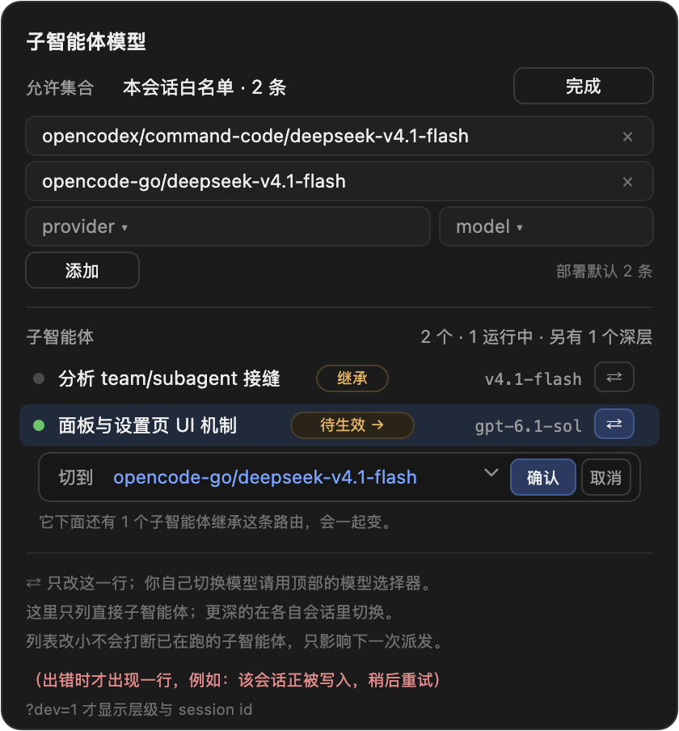

# dsh-subagent-model-router

[中文](#) | [English](README.en.md)

给 DeepSeek Harness 的子智能体一个**可指定、可反复切换、可被会话级白名单约束**的模型路由。有 Agent Teams 时按成员装配，没有 Team 时按 root 会话装配。

- 版本兼容：只在 **0.2.1-rc.5** 上读过接缝，声明窗口 `>=0.2.1-rc.5 <0.3.0`
- 零依赖：纯 ESM，不 import 任何 `@deepseek-ai/*` 包
- 许可：MIT

## 目录

- [特性](#特性)
- [安装](#安装)
- [用法](#用法)
- [配置](#配置)
- [界面](#界面)
- [允许集合的语义](#允许集合的语义)
- [兼容性与降级](#兼容性与降级)
- [副作用与权限](#副作用与权限)
- [故障排查](#故障排查)
- [已知边界](#已知边界)
- [开发与测试](#开发与测试)
- [卸载](#卸载)
- [相关插件](#相关插件)
- [许可](#许可)

## 特性

| 能力 | 入口 | 解决的问题 |
| --- | --- | --- |
| 创建时指定模型 | `spawn_teammate_with_model`（有 Team）/ `spawn_subagent_with_model`（无 Team） | 内置委派只能继承父会话路由，无法把某个子智能体固定到另一个 provider/model |
| 反复中途换模型 | `switch_agent_model` | 端点耗尽（额度、key 失效、代理挂了、持续 4xx/5xx）后原地换路由；旧版只能换一次，第二次起静默失效 |
| 会话级允许列表（强门禁） | `configure_subagent_models` + 底部面板 | 官方 `allowedModels` 只在「模型显式要了路由」时校验，纯继承不受约束；本插件在**每一次子激活**上校验最终路由 |
| 看得见 | header chip / 面板 / 侧栏 hover | 子会话 header 是唯一能看到它实际路由的地方 |
| 不递归 | teammate 作用域没有 spawn 工具 | 子智能体再开子智能体会无限递归，这条在装配层掐掉 |
| 中英双语 | 跟随 harness locale | 面板文案随语言设置切换，无需重载 |

## 安装

前置：DeepSeek Harness 0.2.1-rc.5（0.2 线），Node 20+。装完都要**重启应用**。

### 1. 创造模式里让模型装（最省事）

把 Harness 输入框的模式切到**创造模式**，粘贴：

    安装插件：https://github.com/godot42x/dsh-subagent-model-router
    装好后重启应用，并告诉我是否成功。

模型会调用 `plugin_manager` 工具：依赖与 `dsh.profile.bundles` 一起写好，你只需要重启。桌面版和 Web 版都适用。

### 2. DSH Web（有 `dsh` 命令）

    dsh plugin --profile web add https://github.com/godot42x/dsh-subagent-model-router

命令只装依赖，**不会**改 `dsh.profile.bundles`。装完在 `~/.dsh/profiles/web/package.json` 里加一行：

    "dsh-subagent-model-router"

再重启 `dsh --profile web`。

### 3. DSH Desktop（图形界面，没有 `dsh` 命令）

**设置 → 插件 → 添加插件**，在「包名或地址」里填：

    https://github.com/godot42x/dsh-subagent-model-router

点「安装」，装完重启应用。它会把依赖与 `dsh.profile.bundles` 一次写好。

（想先看它允许什么形式：这个输入框同时接受 npm 包名、GitHub 仓库地址、本地目录的绝对路径。）

### 4. 克隆到本地（要改代码或离线装）

    git clone https://github.com/godot42x/dsh-subagent-model-router
    cd dsh-subagent-model-router

然后二选一：

- **桌面**：设置 → 插件 → 添加插件，填**克隆目录的绝对路径**（如 `/Users/you/code/dsh-subagent-model-router`）。
- **开发联调**（改完立刻生效）：

        ln -s <克隆目录> ~/.dsh/profiles/<profile>/node_modules/dsh-subagent-model-router

  并在该 profile 的 `package.json` 的 `dsh.profile.bundles` 里加入 `dsh-subagent-model-router`，重启。

**一个包只能有一条 Loader 行**：多加一行会让整个 Web 界面失去 `__ModuleLoader__`，表现为白屏或面板全消失。

装好后怎么确认：开一个会话，让模型调 `list_agent_models`——能返回 provider 列表就是装好了；再打开输入框上方/底部的「子智能体」面板看有没有面板。

## 用法

### 工具

| 工具 | 作用域 | 说明 |
| --- | --- | --- |
| `list_agent_models` | 全体 | 不传参列 provider；传 provider 列模型；再传 model 列推理档位 |
| `switch_agent_model` | 全体 | `target` 可以是 teammate 名或子会话 id；只能切自己的直系子会话（或自己） |
| `spawn_teammate_with_model` | 仅 Lead | 在指定路由上创建 teammate |
| `spawn_subagent_with_model` | 仅无 Team 的 root | 在指定路由上开一个普通后台 subagent |
| `configure_subagent_models` | 仅 Lead | 读/写本会话允许列表 |

### 命令

    /subagent-models                     # 人类可读的当前状态
    /subagent-models json                # 面板用的 JSON
    /subagent-models opencodex/a opencodex/b   # 重写本会话名单
    /subagent-models inherit             # 把部署默认值快照进本会话
    /subagent-model-switch self opencodex/b            # 子会话切自己
    /subagent-model-switch <teammate|session-id> opencodex/b

### 例子

    list_agent_models({})
    switch_agent_model({ target: "builder", provider: "opencodex", model: "command-code/b" })
    spawn_teammate_with_model({ name: "builder", description: "修 CI", prompt: "…", provider: "opencodex", model: "command-code/b" })

## 配置

插件行可选字段：

| 字段 | 默认 | 含义 |
| --- | --- | --- |
| `freshProvider` | `spawn` | 新开子智能体用的 subagent provider |
| `forkProvider` | `fork` | fork 型子智能体用的 provider |
| `requireExplicitRoute` | `false` | 打开后**纯继承一律拒绝**，必须显式给 provider+model |
| `enforceDeploymentPolicy` | `true` | 部署里那份列表是硬门禁（false = 只做提示） |

## 界面

三个位置，都是**新增** cell，不替换任何官方 cell：

| 位置 | 显示 | 能做什么 |
| --- | --- | --- |
| `conversation.composer.dock` | `子智能体 · N · M 运行中`（子会话里是 `本子智能体模型`） | 允许集合状态与编辑、直接子智能体列表、每行自带的 `⇄` 切换 |
| `conversation.session.header.actions` | `模型 xxx (effort)`，必要时加 `→ 待生效` | 当前会话真实路由；tooltip 给按模型的子树汇总 |
| `sidebar.session.row.hover` | `模型 xxx` | 不打开子会话就能读到它的路由 |

设计约束：

- **动作跟着目标走**：切某个子智能体就在那一行展开 `切到 [路由 ▾] [确认] [取消]`，没有"先选中再到底部确认"的两段式。
- **只列直接子智能体**：宿主只允许直接父会话改自己的孩子，深层只给"另有 N 个深层"的计数，不渲染不可点的死行。
- **内部结构不外露**：层级号、session id 仅在 `?dev=1` 或 `localStorage['dsh.debug']='1'` 时显示。
- **读不写日志**：允许集合每会话每页只读一次并缓存，反复开关面板不往对话里写命令记录；只有真正的写各留一条。
- **双语**：所有 UI 文案来自插件字典（`zh` / `en`），以命名空间 `dsh-subagent-model-router` 注册到 harness locale 服务；宿主没有该服务时按 `navigator.language` 回退。

## 允许集合的语义

生效顺序：**本会话保存的列表 → 最近的活祖先会话的列表 → 部署默认列表 → 不限制**。

| 状态 | 含义 | 能否从面板进入 |
| --- | --- | --- |
| 本会话白名单 · N 条 | 会话内保存的列表，硬门禁 | 能（编辑 / 导入部署默认） |
| 跟随部署默认 · N 条 | 会话没列表、部署有列表 | 能（新会话天然如此） |
| 不限制 | 两边都没有 | 只能在新会话 |

官方 `subagent/model-selection-policy` 是**追加型**事件且要求至少一条路由，所以**写过列表就撤不回去**；界面因此不给假装可逆的三段式开关。`导入部署默认` 是**一次性快照**，导入后面板保持编辑态，可以继续增删。

判决语义：**策略判决 fail-closed**（路由已知且不在表内就拒），**自身求值异常 fail-open**（记 warn 后放行）。

## 兼容性与降级

- 宿主通过 `DSH_VERSION` / `DSH_HARNESS_VERSION` 声明版本且落在窗口外时，插件**拒绝安装**（只留一条 warn，不注册任何工具）。
- 不声明版本时（当前 dsh 如此）用 `diagnostics().missingSeams` 探测接缝；缺接缝只降级不崩溃。
- 上游改名/改契约时：工具仍注册但带 `note`，系统提示里显式警告，`diagnostics()` 的四个布尔量可体检。

## 副作用与权限

| 动作 | 写了什么 |
| --- | --- |
| 切模型 | 子会话日志追加一条 `model/selection`（热态另有内存覆盖，下一步生效） |
| 改允许集合 | 会话日志追加一条 `subagent/model-selection-policy` |
| 面板读 | 每会话每页一次 `commands/execute`，之后走缓存 |
| 面板写 | 每次用户动作一条 `command/run` |

不读写凭据，不发起网络请求，不修改官方插件代码。

## 故障排查

| 症状 | 原因 | 处理 |
| --- | --- | --- |
| 面板/命令都不出现 | profile 没重启，或包没进 bundles | 重启 profile；核对 `dsh.profile.bundles` |
| 看到两份 chip | 还装着 `dsh-subagents-model` | 卸载它（见[相关插件](#相关插件)） |
| 命令报"未识别" | Host 侧只重载了浏览器 | 重启 profile |
| 点切换没反应 | 目标不是直系子会话，或子会话已释放且宿主无 `sessionQuery` | 进它自己的会话切；或唤醒后重切 |
| 派发被拒 | 路由不在允许集合里 | 加进列表，或清空部署设置后新开会话 |
| 面板报 `writer-held` / `agent-busy` | 目标会话正在被写 | 稍后重试（面板内一行提示，不进对话） |

## 已知边界

- `subagent/descriptor` 只认第一条，事后 append 改不了路由；冷恢复的权威是子会话日志里最新的 `model/selection`。
- `list_agents` 的 `model` 字段来自创建时 options，切换后不一定刷新；以 `switch_agent_model` 返回的 `selected` 为准。
- 允许列表不提供"删除最后一项回到继承"（官方事件要求至少一条）。
- 客户端拿不到逐轮 `request/header`，因此没有"每轮路由历史"，只有 `lastUsed` 与待生效两态。
- 不做自动回退：什么错误算"端点耗尽"、退到哪条路由属于策略，交给人/Lead 决定。

## 开发与测试

    npm run test                 # 三套串行
    node test/smoke.mjs          # Host（有 Team）
    node test/generic.smoke.mjs  # Host（无 Team）
    node test/client.smoke.mjs   # 浏览器半侧

隔离验证（不碰桌面实例）：

    export DSH_HOME=/tmp/dsh-verify
    ELECTRON_RUN_AS_NODE=1 "<App>/Contents/MacOS/DeepSeek Harness" --expose-internals \
      "<App>/Contents/Resources/app.asar/dsh/node_modules/@deepseek-ai/dsh-desktop-host/lib/cli.js" \
      --profile <name> --port 0 --no-open

目录：`lib/`（Host）、`client.js`（浏览器）、`test/`、`docs/plan-and-fixes.md`（调研/设计/修复/接缝表）、`docs/design/`（UI 设计稿）。

## 卸载

    cd ~/.dsh/profiles/<profile>
    # 从 dsh.profile.bundles 与 dependencies 删掉 dsh-subagent-model-router
    rm -f node_modules/dsh-subagent-model-router && pnpm install
    # 重启 profile

已写入的 `model/selection` / 策略事件留在会话日志里，不会被回收，但不再有插件读取。

## 相关插件

- 官方 `dsh-tool-subagent`：本插件复用它的策略事件与投影语义，额外补「纯继承也校验」与「会话内可改」。
- 官方 `dsh-experimental-agent-team`：只读它的 roster 与 `spawnTeammate`，不改它的代码。

## 许可

MIT，见 [LICENSE](LICENSE)。变更记录见 [CHANGELOG.md](CHANGELOG.md)。
